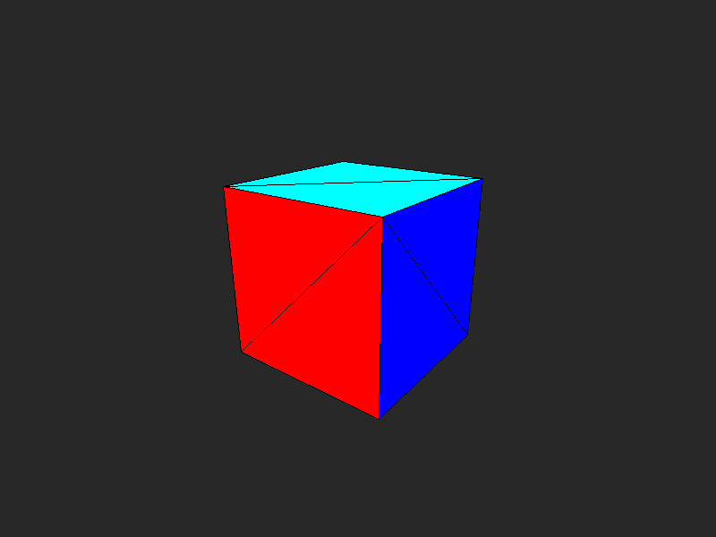
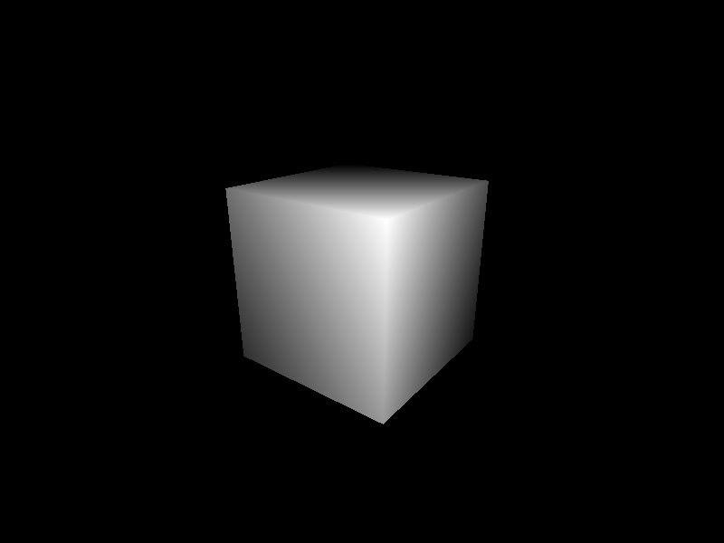

# Software Rasterizer from Scratch

A software rasterizer written in C and C++, built without any graphics libraries or APIs (no OpenGL, no Vulkan). Every pixel is computed by this code. So far, all output is written to PPM and PGM image files.

## Why

Graphics APIs like OpenGL handle the rendering pipeline for you, so it is easy to use them without knowing what happens inside. The goal of this project is to build every stage by hand, to understand what the GPU is actually doing: from transforming vertices to deciding the color of each pixel.

This is also a learning project for moving from C to C++. Stages 1–3 are written in C. From Stage 4 on, the code is in C++.

## Result

| Color | Depth buffer |
|---|---|
|  |  |
| A cube rendered through the full pipeline: model → view → projection → perspective divide → viewport, then filled with edge functions. | The depth buffer, visualized as a grayscale image (near = bright, far = dark). |

## Progress

| Stage | Topic | Language | Status |
|---|---|---|---|
| 1 | Framebuffer and PPM output | C | Done |
| 2 | Line drawing (Bresenham) | C | Done |
| 3 | Filled triangles with edge functions and barycentric interpolation | C | Done |
| 4a | `Vec3` vector class | C++ | Done |
| 4b | `Mat4`, `Vec4`, homogeneous coordinates | C++ | Done |
| 4c | Projection: model → view → projection → viewport | C++ | Done |
| 4d | First 3D cube | C++ | Done |
| 5 | Back-face culling, Z-buffer, hidden-line wireframe, near-plane clipping | C++ | In progress |
| 5.5 | Real-time window and orbit camera (SDL2 for display only) | C++ | Planned |
| 6 | Lighting and textures | C++ | Planned |
| 7 | Path tracer (based on *Ray Tracing in One Weekend*) | C++ | Planned |

## Project Layout

```
graphics_project/
├── include/   C++ headers: math, framebuffer, rasterizer
├── apps/      Demo programs
├── tests/     Test programs
├── stages/    Stage 1–3 C code, kept as a learning record
├── images/    Images used in this README
└── build/     Compiled programs (not in git)
```

### `include/`

| File | Description |
|---|---|
| `math3d.h` | `Vec3`, `Vec4`, `Mat4` and transform matrices (Stage 4) |
| `framebuffer.h` | C++ framebuffer (`std::vector`), depth buffer and depth test, PPM and PGM writers (Stage 5) |
| `raster.h` | `draw_line` (Bresenham with depth test), `draw_triangle` (edge functions with depth test), `is_back_facing` (Stage 5) |

### `apps/`

| File | Description | Output |
|---|---|---|
| `cube.cpp` | Cube mesh, full projection pipeline, near-plane clipping, back-face culling, Z-buffer, solid faces and hidden-line wireframe | `cube.ppm` `cube.pgm` |

### `tests/`

| File | Description | Output |
|---|---|---|
| `math3d_test.cpp` | Test driver for `math3d.h` | prints to terminal |
| `line_test.cpp` | Checks the C++ `draw_line` against the C version with `cmp` | `line_test.ppm` |
| `zbuffer_test.cpp` | Two intersecting triangles: Z-buffer vs. painter's algorithm | `zbuffer_test.ppm` `zbuffer_test_depth.pgm` |

### `stages/`

| File | Stage | Description | Output |
|---|---|---|---|
| `framebuffer.c` | 1 | Framebuffer and PPM writer | `output.ppm` |
| `drawline.c` | 2 | Naive line drawing (baseline for comparison) | `draw_line_naive.ppm` |
| `bresenham.c` | 2 | Bresenham's line algorithm | `draw_line_bresenham.ppm` |
| `edgefunction.c` | 3 | Filled triangles with edge functions, and color interpolation with barycentric coordinates | `edgefunction.ppm` |

## Build and Run

Requires `gcc` / `g++` on Linux. No external libraries.

Each `.c` / `.cpp` file with a `main` compiles on its own. The C++ headers are in `include/`, so C++ files are compiled with `-I include`.

```bash
mkdir -p build

# C stages (example)
gcc -g -Wall -Wextra stages/edgefunction.c -o build/edgefunction
./build/edgefunction

# C++ demo
g++ -std=c++17 -g -Wall -Wextra -Wpedantic -Wconversion -I include apps/cube.cpp -o build/cube
./build/cube

# C++ tests (example)
g++ -std=c++17 -g -Wall -Wextra -Wpedantic -Wconversion -I include tests/zbuffer_test.cpp -o build/zbuffer_test
./build/zbuffer_test
```

Run from the project root. Output images are written to the current directory.

## Design Decisions

### Math and pipeline

- **Right-handed coordinate system.** Verified by checking that x × y = +z.
- **`w = 1` for points, `w = 0` for directions.** This way, translation only affects points.
- **Transforms are read from right to left:** `projection * view * model`.
- **Vertex buffer + index buffer.** The cube stores 8 unique vertices and 12 triangles as index triples, so each vertex is transformed only once.
- **Counter-clockwise winding, seen from outside.** Checked at startup by `check_winding`: the cross product of each triangle must point away from the center.

### Clipping

- **Near-plane clipping happens in clip space, before the perspective divide.** A vertex behind the camera has `w < 0`, and dividing by it flips its position to the other side of the screen. After the divide, this information is lost.
- **Triangles are clipped with Sutherland–Hodgman.** A vertex is inside if `z + w >= 0`. A clipped triangle becomes 0, 3 or 4 vertices; 4 vertices are split into 2 triangles.
- **Intersections are always computed from the inside vertex.** An edge shared by two triangles then gives exactly the same point in both, so there are no cracks between them.
- **Only the near plane is clipped.** Triangles outside the left, right, top and bottom edges are handled by clamping the bounding box. Anything beyond the far plane is rejected by the depth test.

### Rasterization

- **Edge functions instead of scanline.** Fewer special cases, and closer to how real GPUs rasterize triangles.
- **Pixel centers at `(x + 0.5, y + 0.5)`.** Screen coordinates are converted to pixels with `floor`, not rounding or truncation.
- **Rasterizer functions are free functions, not `Framebuffer` members.** The framebuffer stores pixels; the rasterizer is the algorithm (separation of concerns).
- **Back-face culling uses the signed area in screen space, after clipping.** Front faces have a negative area because the y-axis points down on screen. Zero-area triangles are culled too. The signed area is only valid when `w > 0`, so culling is done on the clipped triangles.

### Depth

- **The depth buffer is cleared to 1.0 (the far plane).** A pixel is written only if `z < depth`, so anything at or beyond the far plane is not drawn.
- **The depth test lives in `Framebuffer`.** The depth index (`y * width + x`) is different from the pixel index (`(y * width + x) * 3`), so only the framebuffer needs to know the memory layout.
- **Depth is interpolated linearly in screen space.** NDC z changes linearly across the screen, so barycentric weights can be used directly. Colors and texture coordinates cannot; they will need perspective-correct interpolation in Stage 6.
- **Both culling and the Z-buffer are used.** Culling skips about half of the triangles for speed; the Z-buffer keeps the result correct when front faces overlap.

### Wireframe

- **The wireframe is drawn in a separate pass, after all faces.** Lines are always on top of the faces they belong to, no matter the drawing order.
- **Lines go through the depth test too.** Edges of back faces are hidden by the faces in front of them.
- **Lines use a small depth bias (0.01).** A line lies exactly on its own face, so without a bias the two fight for the same pixels (z-fighting) and the line breaks into dashes. If the bias is too small, the lines are still dashed; if it is too large, hidden edges leak through near the corners.

## References

- [Computer Graphics from Scratch](https://gabrielgambetta.com/computer-graphics-from-scratch/) by Gabriel Gambetta
- [ssloy/tinyrenderer](https://github.com/ssloy/tinyrenderer)
